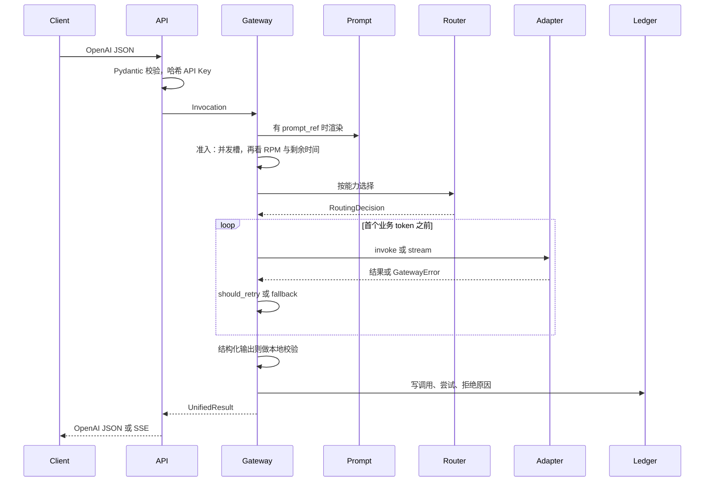

# Mini LLM Gateway 设计说明

本文把网关的职责边界、内部协议、北向翻译、能力路由、执行器、Prompt、观测、错误矩阵和测试收成一份实现依据。代码用 Python 3.11+。本文先写清思路和流程，不在这里展开业务实现。

运行形态是单进程：FastAPI 提供北向接口，Pydantic 做请求边界校验，jsonschema 校验 JSON Schema，httpx 访问上游，SQLite 保存用量和路由决策，配置来自 YAML 与环境变量。

## 1. 网关负责什么

调用方只持有 Gateway API Key，用现有 OpenAI SDK 访问网关支持的 Chat Completions 字段子集；不支持的字段显式返回 400。网关对调用方暴露逻辑模型名，对上游隐藏密钥、地址和协议差异。

网关自己完成这些事：

- 校验调用方身份、请求和 Prompt 变量
- 把外部请求翻译成内部调用，再把内部结果翻译回外部响应
- 按能力、优先级、成本和健康状态选择上游
- 在首个业务 token 之前做有限次重试或 fallback
- 执行普通补全、流式补全和结构化输出校验
- 记录每一次上游调用的路由、用量、延迟、终态和估算成本

网关不负责训练、向量库、RAG、Agent 编排、支付账单、多地域容灾，也不在请求路径上跑 Eval 集。Eval 集挂在 Prompt 版本上，供离线回放；在线路径只把当次决策记下来，让 Eval 以后能解释。

## 2. 三条内部协议

OpenAI Chat Completions 的 JSON 只存在于 API 层。过了这一层，后续模块只认识下面三种内部对象。这样换一个供应商时，改的是适配器，而不是路由、重试和记账。

### 2.1 请求协议：声明需要什么，不声明打到哪台机器

上层声明逻辑模型、消息、需要的能力、超时预算和可选的 Prompt 版本。它不出现 `provider-x/model-2026-08` 这种上游端点。端点由路由器和部署配置决定。

```python
class Capability(StrEnum):
    STREAMING = "streaming"
    STRUCTURED_OUTPUT = "structured_output"
    TOOL_CALLING = "tool_calling"


@dataclass(frozen=True)
class Invocation:
    call_id: str
    trace_id: str
    requested_model: str          # 调用方写下的逻辑模型
    messages: tuple[Message, ...]
    required: frozenset[Capability]
    max_tokens: int | None
    temperature: float | None
    json_schema: dict | None      # 结构化输出时才有
    tools: tuple[ToolSpec, ...]
    prompt_ref: PromptRef | None
    timeout: timedelta
    tenant_id: str
    key_id: str
    tool_choice: str | dict | None = None
```

`requested_model` 在整次调用里保持不变。路由器稍后填上的实际模型写在结果里，不回写覆盖这个字段。

### 2.2 统一结果：两个模型名都留下

无论普通响应还是流式结束，领域层都返回同一种结果。`requested_model` 与 `resolved_model` 必须同时存在。账本、日志和回放都读这一个对象。

```python
class Terminal(StrEnum):
    COMPLETED = "completed"
    REFUSED = "refused"
    ERROR = "error"
    CANCELED = "canceled"


@dataclass(frozen=True)
class UnifiedResult:
    requested_model: str
    resolved_model: str
    provider: str
    content: str
    tool_calls: tuple[ToolCall, ...]
    finish_reason: str
    terminal: Terminal
    usage: TokenUsage
    validation: ValidationResult | None
    provider_request_id: str | None
    refusal: str | None = None
```

北向 JSON 的 `model` 回显 `requested_model`，调用方 SDK 继续按自己请求的名字工作。`resolved_model`、供应商和拒绝原因写入 SQLite 和日志，不塞进 OpenAI 标准字段里。

### 2.3 Adapter 协议：错误也是协议的一部分

每个适配器声明自己支持的能力，并实现普通调用和流式调用。路由器按能力集合匹配，不按模型参数量匹配。

```python
class ModelAdapter(Protocol):
    name: str
    capabilities: frozenset[Capability]

    async def invoke(self, call: UpstreamCall) -> AdapterOutcome: ...
    def stream(self, call: UpstreamCall) -> AsyncGenerator[GatewayEvent, None]: ...


@dataclass(frozen=True)
class UpstreamCall:
    requested_model: str
    resolved_model: str
    base_url: str
    messages: tuple[Message, ...]
    max_tokens: int | None
    temperature: float | None
    json_schema: dict | None
    tools: tuple[ToolSpec, ...]
    timeout: timedelta
    tool_choice: str | dict | None = None
```

`stream` 返回可显式 `aclose()` 的异步生成器，执行器在成功、异常和取消路径都会关闭它。`AdapterRegistry` 按 `ModelAdapter` 协议存储和返回适配器，启动时检查能力集合。

适配器对上只抛 `GatewayError`，或在流里产出错误事件。供应商 HTTP 正文、密钥和原始堆栈留在适配器内部。稳定错误码才进入重试和记账。

```python
class Code(StrEnum):
    UNAUTHENTICATED = "unauthenticated"
    KEY_DISABLED = "key_disabled"
    INVALID_REQUEST = "invalid_request"
    PROMPT_INVALID = "prompt_invalid"
    NO_COMPATIBLE_MODEL = "no_compatible_model"
    MODEL_UNAVAILABLE = "model_unavailable"
    ADMISSION_REJECTED = "admission_rejected"
    DEADLINE_TOO_SHORT = "deadline_too_short"
    UPSTREAM_UNAVAILABLE = "upstream_unavailable"   # 连接失败、短暂 5xx
    UPSTREAM_OVERLOADED = "upstream_overloaded"    # 429、超时、过载
    UPSTREAM_ERROR = "upstream_error"              # 其他上游失败，含上游 401
    OUTPUT_INVALID = "output_invalid"
    CONTENT_REJECTED = "content_rejected"
    CANCELED = "canceled"
    INTERNAL = "internal"


class GatewayError(Exception):
    code: Code
    message: str          # 可以返回给调用方
    retryable: bool
    stage: str            # 见第 10 节的阶段名
    provider_request_id: str | None
    cause: BaseException | None   # 不进入 str(error)，也不进响应
```

`MODEL_UNAVAILABLE` 表示存在兼容模型，但当前没有可用上游，北向为 503；`NO_COMPATIBLE_MODEL` 表示模型不存在或能力不匹配，北向为 404。

上游用自己的密钥认证失败时，码是 `UPSTREAM_ERROR`，北向仍是 502。这样调用方的 401 只表示 Gateway Key 无效。

## 3. 分层与目录

目录对齐课程中的项目结构。依赖只向下：`api` 与 `schemas` 做翻译，`services` 做编排，`core` 放纯规则，`upstream.py` 是适配器。

```text
llm-gateway/
├── app/
│   ├── api/routes.py          # Chat、Prompt、模型列表
│   ├── core/                  # 协议、错误、鉴权规则、限流决策、重试条件
│   │   ├── errors.py
│   │   ├── models.py
│   │   ├── auth.py
│   │   ├── admission.py
│   │   └── retry.py
│   ├── services/
│   │   ├── gateway.py         # 编排：校验之后的整次调用
│   │   ├── execution.py       # 每次调用和 attempt 的共享状态
│   │   ├── accounting.py      # 记录组装、用量估算、费用汇总、指标收尾
│   │   ├── router.py          # 能力匹配、优先级、fallback、决策记录
│   │   ├── upstream.py        # OpenAI 兼容适配器
│   │   ├── prompts.py         # 版本、变量校验、沙箱渲染
│   │   ├── structured.py      # JSON 提取、Schema 校验、有限次修复
│   │   └── usage.py           # SQLite 行模型、持久化与查询
│   ├── config.py
│   ├── schemas.py             # 北向 Pydantic 模型
│   └── main.py                # 生命周期与依赖组装
├── tests/                     # MockTransport 驱动
├── gateway.example.yaml
├── pyproject.toml
├── Dockerfile
└── docker-compose.yml
```

| 模块 | 可以依赖 | 不能依赖 |
| --- | --- | --- |
| `app.core` | 标准库 | FastAPI、Pydantic 的请求模型、httpx、SQLite、`services` |
| `app.services` | `core`，以及各自的端口 | 在 `gateway.py` 里直接拼供应商 JSON |
| `app.services.upstream` | `core`、httpx | FastAPI、`router`、`prompts` |
| `app.api`、`schemas` | FastAPI、Pydantic、`core`、服务入口 | 供应商 URL 与密钥 |
| `app.main` | 上面全部具体类型 | 业务判断 |

`core` 里的重试、准入和路由比较都是纯函数，测试不需要睡眠，也不需要网络。

`GatewayService` 决定何时开始或结束 attempt、是否重试或修复，以及何时向客户端发送事件。`CallRecorder` 根据 `CallState` 和 `AttemptState` 生成账本记录，处理用量估算、Decimal 费用累计和调用指标；SQL 仅由 `Ledger` 执行。共享状态属于单次请求，记账组件可以复用于多次调用。attempt 只有落库成功后才加入汇总，call 只有落库成功后才标记为已保存；重复收尾不重复写入或累计指标。写入异常继续向执行器传播，当前尚未引入异步写入队列或失败补偿。

API 响应中的 usage 仍对应最终返回的 attempt，调用账本累计本次所有 attempt，包括失败、重试、fallback 和结构化修复。接口类型检查覆盖执行器、共享状态、记账、路由、适配器、准入、内部协议和应用组装；其他模块尚未纳入该检查范围。

## 4. 一次调用怎么走完

普通调用是最短的一条路，也是重试和 fallback 的基准：同步请求，进入上游，拿回完整响应，翻译成 `UnifiedResult`。



各步的职责：

1. **API 层**读 body、生成 `trace_id` 与 `call_id`、校验 OpenAI 字段、把 Bearer token 做成 SHA-256 去查 Key。失败在这里结束，不进路由器。
2. **Prompt**只在请求带了 Prompt 引用时工作。变量先过 Schema，再渲染。缺变量或超长直接拒绝，请求不会到达上游。
3. **准入**先占并发槽，再扣 RPM。剩余超时如果已经短到无法完成一次上游读取，直接拒绝。并发槽在成功、失败和取消时都释放。RPM 不退回。
4. **路由器**返回选中的目标和每个落选候选的原因。原因要能持久化。
5. **执行器**调用适配器。连接失败和首 token 之前的过载可以有限次重试；另一个候选只在还没有向调用方发出业务 delta 时启用。
6. **结构化输出**在拿到完整文本后做本地校验。修复有次数上限。
7. **账本**成功、拒绝、失败和取消都记录。成功或拒绝在对外终态之前写入；错误和取消在结束或清理时写入。
8. **API 层**把 `UnifiedResult` 翻译回 OpenAI 响应。供应商密钥不出现在响应和日志里。

流式在第 5 步改成事件流，其余步骤相同。细节在第 7 节。

## 5. 北向 API

目标是已有 OpenAI SDK 不用改地址以外的代码就能接入。兼容工作在 API 层做完。

### 5.1 Schema

`schemas.py` 用 Pydantic 描述 Chat Completions 的请求和响应。本期接受的字段：

- `model`、`messages`、`max_tokens`、`temperature`、`stream`、`user`
- `stream_options.include_usage`，仅在 stream=true 时接受；其他 stream_options 字段显式拒绝
- `response_format`，仅当类型是 `json_schema` 时进入结构化输出；完整保留 json_schema.name、description、strict 与 schema，未知封装字段拒绝。旧的直接 Schema 写法继续兼容，默认名称为 response
- `tools` 与 `tool_choice`，对应能力 `tool_calling`。tool_choice 支持 none、auto、required 和指定函数；指定函数必须存在于合并后的工具定义中
- 网关扩展 `prompt`：`name`、`version`、`variables`

出现图像、音频、Responses API 字段时返回 400。`messages[].content` 接受字符串；assistant 带 `tool_calls` 时允许 content 为 null。支持 `role=tool` 和必填的 `tool_call_id`，并保留 assistant 的历史工具调用。`n` 只接受 1。`temperature` 若存在，必须在 0 到 2。

### 5.2 请求规范化

路由函数做完 Pydantic 校验后，立刻变成 `Invocation`：

- `model` 变成 `requested_model`
- `stream=true` 时 `required` 包含 `STREAMING`
- 带 JSON Schema 时包含 `STRUCTURED_OUTPUT`
- 带 tools 或工具调用历史时包含 `TOOL_CALLING`
- Key 上的 `tenant_id`、`key_id` 写入调用
- `user` 不进日志

从这个函数返回之后，服务层看不到 Pydantic 模型。

### 5.3 FastAPI 路由

`app/api/routes.py` 声明：

- `POST /v1/chat/completions`
- `GET /v1/models`，只列出该 Key 可见的逻辑模型
- `POST /v1/prompts/render` 仅供调试已发布模板，不单独打上游

依赖注入提供已经组装好的 `GatewayService`。处理函数里不读取供应商密钥，也不拼接上游 URL。

ASGI 中间件先建立 trace 上下文，再在读取 body 时累计字节数；即使 Content-Length 缺失或偏小，也在超出上限时拒绝，不进入路由或上游。中间件在响应结束时记录访问日志。鉴权依赖只挂在 `/v1/` 上。

### 5.4 响应翻译

成功的普通响应：

- `model` 等于 `requested_model`
- `choices[0].message.content` 来自统一结果；工具调用同时返回完整的 tool_calls 数组。后续请求中的 tool 消息和 assistant 历史工具调用原样翻译给上游
- 返回 created 和 OpenAI usage；usage 表示最终返回那次 attempt 的用量，修复或重试的全部消耗在调用账本中累计，不能把单个响应 usage 当成整次调用成本
- 流式 include_usage=true 时，结束 chunk 后、[DONE] 前发送 choices=[] 的最终用量 chunk；其余 chunk 的 usage 为 null。未开启时不发送用量 chunk

错误响应：

```json
{
  "error": {
    "message": "model not found",
    "type": "invalid_request_error",
    "code": "no_compatible_model"
  },
  "request_id": "6f1c0b2e9a774c1d"
}
```

`message` 只用 `GatewayError.message`。响应头 `X-Request-Id` 与 `request_id` 相同，值是 `trace_id`。

| 领域码 | HTTP | 调用方看到的 message |
| --- | --- | --- |
| `invalid_request` | 400 | 具体校验原因 |
| `prompt_invalid` | 400 | prompt variable rejected |
| `unauthenticated` | 401 | invalid api key |
| `key_disabled` | 403 | api key disabled |
| `no_compatible_model` | 404 | model not found |
| `model_unavailable` | 503 | model temporarily unavailable |
| `admission_rejected` | 429 | concurrency limit exceeded 或 rate limit exceeded |
| `deadline_too_short` | 429 | deadline too short |
| `upstream_error`、`upstream_unavailable`、`upstream_overloaded` | 502 | upstream request failed |
| 网关超时 | 504 | gateway timeout |
| `output_invalid` | 502 | output validation failed |
| `content_rejected` | 400 | content rejected |
| `canceled` | 无正文 | 客户端已断开 |
| `internal` | 500 | internal error |

## 6. 能力注册与路由

### 6.1 注册表

配置里的每个上游模型在启动时变成一条能力记录，放进内存注册表：

```python
@dataclass(frozen=True)
class ModelSpec:
    logical_model: str
    provider: str
    resolved_model: str
    base_url: str
    capabilities: frozenset[Capability]
    priority: int          # 数字小的先尝试
    input_cost: Decimal
    output_cost: Decimal
    timeout: timedelta


class AdapterRegistry:
    def specs_for(self, logical_model: str) -> tuple[ModelSpec, ...]: ...
    def adapter_for(self, provider: str) -> ModelAdapter: ...
```

适配器在构造时声明能力。注册表要求 `ModelSpec.capabilities` 是该适配器能力的子集，否则进程启动失败。

### 6.2 选择规则

路由器的输入是逻辑模型和 `required` 能力集合，输出是可解释的决策：

```python
@dataclass(frozen=True)
class Rejection:
    provider: str
    resolved_model: str
    reason: str   # capability_mismatch、unhealthy、priority_lost


@dataclass(frozen=True)
class RoutingDecision:
    requested_model: str
    selected: ModelSpec | None
    candidates: tuple[ModelSpec, ...]
    rejections: tuple[Rejection, ...]
```

排序只在「能力齐全且健康」的候选中进行，依据是 `priority`，相同优先级再比预估成本。健康状态来自连续失败后的熔断标记。默认连续 3 次失败后打开熔断，冷却 30 秒；冷却后允许一个半开探测，其余请求继续排除这个上游。探测成功关闭熔断，失败或取消后重新冷却。路由只检查状态，在真正发起 attempt 时才预留探测名额，未使用的 fallback 不占名额。熔断打开的候选写入 `unhealthy`。不存在兼容模型返回 `NO_COMPATIBLE_MODEL`；兼容模型全部不可用返回 `MODEL_UNAVAILABLE`。

同一次决策里的候选列表和拒绝原因原样写入 SQLite，供以后的 Eval 回放。在线请求不跑 Eval 集。

### 6.3 Fallback 的边界

fallback 是换一个已经记录过的候选，再执行一次普通调用或重新打开一条流。

允许 fallback 的条件同时成立：

- 当前失败发生在首个业务 delta 或 tool_call 发给调用方之前
- 还有未尝试的兼容候选
- 错误属于连接失败、短暂 5xx、429、超时或过载

已经向调用方写出第一个业务事件之后，流只能结束。不能把另一个模型的后文接在前面的 delta 后面。

## 7. 普通输出、流式与唯一终态

### 7.1 普通执行器

`GatewayService.complete` 走第 4 节的直线路径。适配器返回完整文本、tool call 和 usage。执行器补上 `requested_model`，并在供应商没给 usage 时用估算值，同时把 `estimated=True` 记进账本。

估算规则：每条消息 `4 + ceil(字符数 / 4)`，补全文本同样计算。这是缺口时的近似，用来记账，不冒充分词器结果。

### 7.2 流的内部事件

适配器把供应商的 SSE 收成内部事件。API 层再把这些事件写成对外的 SSE。服务层不写 `data:` 帧。

```python
class EventKind(StrEnum):
    DELTA = "delta"
    REFUSAL = "refusal"
    TOOL_CALL = "tool_call"
    USAGE = "usage"
    FINISH = "finish"
    DONE = "done"
    ERROR = "error"


@dataclass(frozen=True)
class GatewayEvent:
    kind: EventKind
    text: str = ""
    tool_call: ToolCall | None = None
    usage: TokenUsage | None = None
    error: GatewayError | None = None
    finish_reason: str | None = None
    provider_request_id: str | None = None
```

适配器把 finish_reason 转成内部 FINISH，继续读取最终 USAGE，直到收到 [DONE] 才生成内部 DONE。EOF、错误 envelope 或非法 JSON 都是失败，不能补成成功。上游必须同时提供 finish_reason 与 [DONE]。内部 FINISH 不直接透传；对外完成 chunk 保留实际 finish_reason。工具调用增量携带 index，同一帧中的多个工具调用全部保留。

对外 SSE 始终是 OpenAI 的 chunk 格式，最后一帧是 `data: [DONE]`。内部的 `DONE`、`ERROR` 与取消不会原样暴露成另一套事件名。

### 7.3 终态只有一个

一条流结束的原因只能是下面之一：正常完成、模型拒绝、错误、取消。执行器通过统一运行上下文保证调用摘要只写一次，每个实际发起的 attempt 也只落一条记录。

- 供应商 message.refusal、delta.refusal 或 content_filter 转成原生拒绝响应：普通响应保留 message.refusal，流式保留 delta.refusal，HTTP 仍为 200；账本 terminal=refused、error_code=content_rejected。拒绝不做 JSON 校验、修复或故障转移；已收到拒绝后发生断流也不能换模型。网关自身的内容策略错误仍按 400 映射
- 发出 `DONE` 后不再发 `ERROR`
- 发出 `ERROR` 后不再补一个成功的 `DONE`
- 客户端断开记为 `CANCELED`，并关闭上游迭代器和 HTTP 响应，释放并发槽。普通调用和首个流式事件之前也监听断连。账本内部使用 http_status=499 表示取消，不向已断开的客户端发送 499
- `USAGE` 可以出现在终态之前，不能当成终态

API 层一旦写出了错误帧或 `[DONE]`，就不再改状态码，也不再换模型。

### 7.4 TTFT

调用级 TTFT 是从进入网关服务，到第一个向 API 层交付的 `DELTA` 或 `TOOL_CALL` 的时间。attempt 级 TTFT 则从该 attempt 发起到上游首个业务片段。连接建立、响应头到达都不算首 token。没有业务事件就失败的调用，TTFT 记为空，总延迟仍要记录。

## 8. 结构化输出

结构化输出有两层，两层都要过。供应商接受了 JSON Schema，只说明上游愿意按这个形状生成，不代替本进程的校验。

1. **请求层。** API 把 `response_format.json_schema` 放进 `Invocation.json_schema`。路由器只选择声明了 `STRUCTURED_OUTPUT` 的候选。适配器把 schema 交给上游。
2. **本地层。** 普通调用在 `invoke` 返回后，用 jsonschema 按同一 Schema 校验文本。流式调用先增量拼接，流结束拿到完整字符串后再做这一次校验。半截 JSON 不做通过与否的结论。

修复也有边界：

- 从模型文本提取一个 JSON 值，再交给标准校验器；允许有前缀说明或 Markdown 围栏，拒绝多个连续 JSON 对象及 NaN/Infinity
- 校验失败时，最多再请求上游修复固定次数（默认 1 次）
- 修复请求算新的 attempt，kind=repair；原始生成记录为 kind=generation。编号在整次调用内单调递增，失败的生成和修复同样保留用量、费用与输出哈希。修复本身遇到上游错误时结束调用，不能通过重新生成来重置修复次数，可能再次计费
- 次数用完仍失败，返回 `OUTPUT_INVALID`，保留原始文本的哈希，不把非法 JSON 当成成功内容

本地支持 JSON Schema Draft 2020-12，包括组合、数组约束和本地引用；启用 format 校验。请求的输出 Schema 和工具参数 Schema 在打上游前先做合法性检查；外部引用和其他显式 dialect 返回 400，校验不会联网。校验不做类型转换、不补缺失属性，也不删除允许的额外属性。

结构化流采用完整缓冲：校验或修复成功后才发送内容。因此调用级 TTFT 包含生成及校验时间；上游首片段时间仍在 attempt 中单独保留。工具调用终态保留工具调用，不对空 content 做 JSON 输出校验。

流式结构化输出在终态之前不向调用方宣称「已经符合 Schema」。校验发生在内部 `DONE` 之后、对外 `[DONE]` 之前。校验失败则对外终态是错误，而不是先成功再改口。

## 9. Prompt Bundle

Prompt 以可发布的版本包存在，每次调用引用名称、版本和变量。渲染结果进入 `Invocation.messages`，原始模板不发给上游。

一个可发布版本至少包含：

| 部分 | 作用 |
| --- | --- |
| System Prompt 模板 | 渲染后的系统消息 |
| 输入变量 Schema | 渲染前校验 |
| Few-shot 示例 | 渲染后按顺序变成消息 |
| 输出 JSON Schema | 可空；有则要求 `STRUCTURED_OUTPUT` |
| 工具定义版本 | 可空；有则要求 `TOOL_CALLING` |
| 默认逻辑模型和生成参数 | 请求没写模型时使用 |
| Context 预算 | 渲染后的估算 token 上限 |
| Eval 集与通过门槛 | 只随版本保存，请求路径不执行 |
| 变更说明和状态 | `draft`、`published`、`retired` |

只有 `published` 可以被调用。`retired` 拒绝并说明版本已下线。

渲染使用沙箱模板：允许变量替换和条件分支，不执行任意 Python，不调用 `eval` 或 `exec`。实现选 Jinja2 的 SandboxedEnvironment 与 StrictUndefined，限制危险属性访问，清空过滤器和全局对象；模板引用未提供变量时返回 PROMPT_INVALID，传入的上下文只有变量字典。

输入变量与输出使用同一 Draft 2020-12 标准校验器，执行嵌套对象、数组、数值边界、组合和 additionalProperties 规则；未声明 additionalProperties 时按标准允许额外属性，不再使用手写的隐式禁止规则。启动时校验变量 Schema，并拒绝重复的 (name, version)。变量校验失败、渲染后超过 context 预算，都返回 `PROMPT_INVALID`。这类错误要求调用方修正请求后再发，网关不会自动重试。

每次真正发出去的调用记录 Prompt 的名称、版本、模板哈希和 Schema 版本。哈希覆盖模板正文和 few-shot，这样回放时能确认当时用的是哪一版字节。

请求同时带了 `messages` 和 `prompt` 时，渲染结果作为前缀，调用方消息接在后面。变量只来自 `prompt.variables`。

## 10. 错误、重试、限流

每个阶段的失败处理不同。下表是执行器必须遵守的策略。

| 阶段 | 典型错误 | 处理 |
| --- | --- | --- |
| 认证 | API Key 无效、租户或 Key 禁用 | 立即返回，不重试 |
| 请求校验 | 参数非法、Schema 缺失 | 立即返回，不重试 |
| Prompt | 缺变量、超过预算 | 立即返回，由调用方修正后再发 |
| 路由 | 没有兼容模型 | 立即返回；配置改完后由调用方再发 |
| 排队 | 并发已满、剩余时间不够 | 拒绝；并发满返回 429，时间不够返回 `deadline_too_short` |
| 连接 | 网络抖动、短暂 5xx | 有限次重试 |
| 首 token 前 | 429、超时、过载 | 有限次重试，或 fallback 到下一候选 |
| 已流式输出 | 连接中断 | 结束流，不自动换模型重生成 |
| 输出校验 | JSON 或 Schema 不通过 | 有限次修复 |
| 内容拒绝 | 安全策略拒绝 | 结束调用，不换模型绕过 |

纯函数：

```python
def should_retry(stage: str, code: Code, attempt: int, max_attempts: int, business_event_sent: bool) -> bool: ...

def should_fallback(code: Code, business_event_sent: bool, remaining_candidates: int) -> bool: ...

def backoff(retry_index: int, random01: float) -> timedelta:
    """retry_index 从 1 开始。基数 200ms，指数增长，上限 2s，再乘以 0.5 到 1.5 的抖动。"""
```

`max_attempts` 默认 2，表示首次失败后最多再试一次。测试注入 `random01` 和时钟，断言等待时长，不真正 `sleep`。

Prompt 默认参数合并后，再统一检查 max_tokens、temperature、输出和工具参数 Schema。省略 max_tokens 时向上游传递 max_tokens_cap；显式超出上限则返回 400。repair_max_attempts=0 可以关闭修复。

并发槽比 RPM 更先判断。一个 Key 的在途请求数到达 `max_concurrency` 时直接拒绝，即使这一分钟的请求数还没用完。令牌桶容量等于该 Key 的 `rpm`，按分钟连续补充。

重试和 fallback 都会再次打到上游，供应商可能重复计费。账本把每一次实际发起的 attempt 分开记，调用级 token 用量与成本均是各次之和，包括失败、修复和取消的 attempt。上游未返回用量时使用估算；尚未收到响应的失败只能记录未知用量（零值并标记 estimated），不能视为已确认免费。网关不用幂等键去抵消这次费用。

内容拒绝若以后接入审核，审核失败的码固定为 `CONTENT_REJECTED`，路由器不得因为这个码去换一个更宽松的模型。

## 11. 每次调用记录什么

一次逻辑调用下面可以有多次上游 attempt。两张事实都要留：调用摘要，以及每次 attempt 的明细。

| 维度 | 字段 |
| --- | --- |
| 关联 | `trace_id`、`run_id`、`step_id`、`call_id` |
| 路由 | 逻辑模型、供应商、`resolved_model`、候选列表、拒绝原因 |
| Prompt | 名称、版本、哈希、Schema 版本 |
| 用量 | input、output、cached、reasoning；缺省时标记 estimated |
| 延迟 | queue、route、TTFT、generation、total |
| 弹性 | attempt、是否 retry、是否 fallback、超时预算 |
| 结果 | finish reason、终态、输出校验结果 |
| 错误 | 稳定错误码、北向 HTTP 状态、供应商 request id |
| 成本 | 输入、输出、缓存命中与总计，用注册表里的单价估算 |

`run_id` 和 `step_id` 由调用方通过请求头传入；没有则留空。网关始终生成 `trace_id` 和 `call_id`。同一次 fallback 链共用 `call_id`，attempt 递增。

三类观测分开写：

- **指标**只保留聚合：QPS、延迟分位、错误率，标签是逻辑模型、供应商和终态。进程内先累加，测试可直接读。
- **日志**一行对应一次 attempt，字段来自上表，消息正文默认不打印。调试开关打开时也只保留截断后的摘要，并抹掉密钥。
- **账本**用 SQLite 保存上表，作为可以按 `trace_id` 回放的记录。Trace 在本期就是这组 id 加上账本行，不引入单独的导出系统。

TTFT 与总耗时的定义见第 7.4 节。连接耗时可以记在 attempt 明细里，但不能填进 TTFT。

## 12. 配置

密钥只出现在环境变量中。YAML 写变量名。启动时读取、哈希、放进 Key 库，然后丢掉明文。

```yaml
server:
  addr: "0.0.0.0:8080"
  gateway_timeout: 60s
  max_body_bytes: 1048576
  shutdown_grace: 15s

limits:
  max_tokens_cap: 4096
  retry_max_attempts: 2
  repair_max_attempts: 1
  circuit_failure_threshold: 3
  circuit_cooldown: 30s

log:
  level: info
  debug_payload: false
  payload_max_runes: 200

providers:
  - name: openai
    base_url: https://api.openai.com/v1
    api_key_env: OPENAI_API_KEY
    upstream_timeout: 90s
    allowed_hosts:
      - api.openai.com
    capabilities:
      - streaming
      - structured_output
      - tool_calling

models:
  - logical_model: gpt-4o-mini
    provider: openai
    resolved_model: gpt-4o-mini
    priority: 1
    input_cost_per_million: "0.15"
    output_cost_per_million: "0.60"
    capabilities:
      - streaming
      - structured_output
      - tool_calling

keys:
  - id: demo
    secret_env: GATEWAY_DEMO_KEY
    tenant_id: demo
    status: active
    rpm: 60
    max_concurrency: 4
    allowed_models: []

prompts:
  directory: ./prompts
```

`allowed_models` 为空表示该 Key 可以使用配置里的全部逻辑模型。非空时，请求的逻辑模型必须命中列表。

本地 mock 可以使用 `http://127.0.0.1:端口/v1`，并把 `127.0.0.1` 写进 `allowed_hosts`。除 `localhost` 与 `127.0.0.1` 外，scheme 必须是 `https`。URL 不允许 userinfo。`gateway_timeout` 必须短于该模型所属 provider 的 `upstream_timeout`，这样网关先到期并取消上游，再返回 504。

启动时校验失败就退出：模型路由的 (logical_model, provider, resolved_model) 三元组、provider 名、Key id 各自唯一；模型引用的 provider 存在；能力是适配器能力的子集；环境变量非空；`rpm` 与 `max_concurrency` 大于 0；body 上限、max_tokens_cap、retry_max_attempts、熔断阈值为正整数，repair_max_attempts 为非负整数，持续时间为有限正数。

Prompt 文件放在 `prompts/` 下，一个发布版本一个 YAML，由 `services/prompts.py` 在启动时加载。状态不是 `published` 的版本可以加载，但不能被调用。

## 13. 组装

`app/main.py` 只做组装：

1. 读取配置路径，默认 `gateway.yaml`。
2. 加载 YAML 与环境变量，运行启动校验。
3. 打开 SQLite，建调用表、attempt 表和路由拒绝表。
4. 为每个 provider 建立一个 httpx 客户端和 `OpenAIAdapter`，超时等于 `upstream_timeout`。
5. 建立注册表、路由器、Prompt 库、执行器和 FastAPI 应用。
6. 用 uvicorn 监听。收到 SIGINT 或 SIGTERM 后停止接新请求，等待 `shutdown_grace`。

进入网关服务时建立绝对 deadline，Prompt、准入、上游读取、重试等待与修复共享同一预算。每次等待上游事件时单独使用 asyncio.timeout_at，退出该超时上下文后才 yield；不让绑定某个任务的 timeout 跨越流式 yield，因为首片段预读和后续传输可能由不同任务执行。httpx 共享取消信号，每次上游请求也设置剩余预算。客户端超时是更长的兜底。

## 14. 测试

测试用适配器的 `httpx.MockTransport` 和执行器的假时钟，不访问真实供应商，也不真正睡眠。

| 测试 | 要证明的事 |
| --- | --- |
| Adapter 契约 | 内部 `UpstreamCall` 变成的上游 JSON 符合 OpenAI 兼容请求；上游 JSON 能变回统一结果或 `GatewayError`。响应和异常文本里没有上游密钥 |
| 路由器 | 能力不匹配被拒绝；优先级和成本顺序正确；fallback 顺序与决策一致；每条拒绝原因被写入账本 |
| 重试 | MockTransport 连续返回连接错误或 429。attempt 次数、`backoff` 的等待时间符合策略。测试断言计划等待的时长，不调用真的 sleep |
| 流式 | 事件顺序是若干 delta、可选 usage、然后恰好一个终态。首个 delta 发出后再注入断连，确认没有第二个模型的输出，终态是错误或取消 |
| 结构化输出 | 提取 JSON、标准 Schema 校验、修复次数达到上限后返回 `OUTPUT_INVALID`。半截流不做「已通过」结论 |
| 可观测性 | 同一次 fallback 的多条 attempt 共用 `call_id`。账本含逻辑模型、`resolved_model`、拒绝原因、TTFT、终态和估算成本。TTFT 对应第一个业务 delta，而不是连接建立 |
| core 边界 | 用 `ast` 扫描 `app/core`。出现 `fastapi`、`httpx`、`sqlite3`、`app.services` 即失败 |
| API | 用 `httpx.ASGITransport` 覆盖 200、SSE、401、403、404、429、502。502 响应里找不到测试用的上游密钥 |
| 独立记账组件 | 不启动 HTTP 即可验证各 attempt 汇总、交错调用隔离、重复收尾、取消时的部分用量、准备失败的 Prompt 引用及数据库写入失败后的状态 |

日常入口见根目录 README：先运行 `uv sync --locked --extra dev`，再通过 `uv run --locked --extra dev` 执行 `pytest`、`ruff check app tests scripts` 和 `mypy`。`pyproject.toml` 固定本轮类型检查的模块范围，并要求这些模块的函数签名完整，检查函数体和意外返回的 `Any`。`uv.lock` 固定运行与开发依赖；GitHub Actions 对 Python 3.11 / 3.12 / 3.13 运行上述检查，并独立构建 Docker 镜像、检查 CLI 和 Compose 配置。工作流不读取真实上游密钥。

验收时可以用 curl 打同一套 mock：

- 普通请求和流式请求都能经网关返回
- 错误 Key 为 401，并发或 RPM 超限为 429，没有兼容模型为 404，上游 5xx 为 502
- 响应和日志不含 `Authorization` 与上游密钥
- 日志含 `trace_id`
- 调用结束后能按 `trace_id` 在 SQLite 里找到调用行和 attempt 行

## 15. 建议的实现顺序

按这条顺序写，每一步都有可以独立运行的测试：

1. `core` 的协议、错误码和纯函数，加上 import 边界测试。
2. FastAPI 的 Schema、鉴权和普通 Chat 路径，适配器先打到 MockTransport。
3. 内部事件和 SSE，保证终态只有一个。
4. 能力注册、路由决策落库，以及首 token 前的重试和 fallback。
5. SQLite 补齐第 11 节的字段，并把指标和日志分开。
6. 结构化输出的本地校验和有限次修复。
7. Prompt 版本、沙箱渲染和调用记录里的模板哈希。

安全拒绝换模型、Eval 执行、Prometheus 抓取、管理后台和多实例限流不放进上述步骤。规则先写在第 10 节和第 11 节，避免以后实现时把它们做成隐式行为。

## 16. 回归验收

新增测试按以下边界验收：

- 工具选择透传、普通工具调用返回、工具结果回传，以及并行工具流式分片。
- finish_reason 后读取 usage、异常 EOF、错误事件、非法上游响应，成功和错误终态互斥。
- 普通及流式 JSON 修复的唯一 attempt 编号、失败记录、累计费用和修复关闭开关。
- 熔断冷却、单个半开探测、失败重新冷却、取消释放以及无需重启的恢复。
- 普通与流式 ASGI 断连、取消记录、部分输出费用、首片段前后超时和上游资源关闭。
- 缺失或伪小 Content-Length 的分块请求限制、输出上限缺省值和 Prompt 合并后校验。
- Draft 2020-12 的数组、组合、本地引用、format 和数据保真；非法 Schema 在上游之前拒绝。
- SQLite 通过追加列支持原有账本，保留历史 attempt。新增 kind、output_hash 和查询索引，不重算旧数据。

## 17. 官方 SDK 验证、持久化与性能测量

开发验证依赖安装：

```bash
uv sync --locked --extra dev
uv run --locked --extra dev pytest -q
uv run --locked --extra dev python scripts/benchmark.py --requests 100 --db-pairs 500
```

SDK 契约测试使用官方 openai 包，覆盖普通响应、parse、stream、流式结构化输出的 get_final_completion、原生 refusal 和可选用量；不会向真实供应商发送内容。benchmark.py 另外启动仅监听 127.0.0.1 的两个真实 HTTP 服务，路径为 SDK → 网关 → 受控上游，测量 0/20ms 上游延迟和并发 1/4/16，流式额外设置两段输出之间的 5ms 间隔。每组普通请求 100 次、流式 20 次，预热 10 次；关闭 SDK 重试，延迟不含客户端并发信号量排队。数据库保持当前同步逐行提交，记录 save_attempt/save_call 的提交耗时及 event loop lag，并单独测量 500 对 attempt/call 写入（1000 次提交）。

原始结果保存于 benchmark-results.json；本机测试受短响应、两个服务与负载发生器共进程、操作系统缓存及实时负载影响，不能视为真实模型吞吐或生产容量上限。

Docker Compose 通过 GATEWAY_DATABASE=/srv/data/gateway.db 将账本写到 gateway-data 命名卷，优先级高于 YAML 路径。停止或重建容器保留该卷；docker compose down -v 会显式删除它。已有容器若把数据库写在 /srv/gateway.db，迁移前须先备份旧文件并放到新卷，配置修改不会自动搬运旧账本。当前环境未安装 Docker CLI，验证范围为 Compose 配置检查和 SQLite 关闭后重开。

真实上游验证需显式配置，网关自身不会自动加载 .env；本地启动时由 README 中的 uv --env-file 命令注入，验证脚本也可显式读取：

```bash
cp .env.example .env
# 在本地填写 UPSTREAM_BASE_URL、UPSTREAM_MODEL、OPENAI_API_KEY
uv run --locked --extra dev python scripts/verify_live.py --env-file .env
# 若 Key 使用其他环境变量名，追加 --api-key-env YOUR_KEY_ENV
```

.env 已从版本控制排除。真实验证只发送合成的无敏感内容，默认最多 8 次上游请求、最多 2 并发、每次最多 32/64 个输出 token，关闭 SDK/网关重试和修复。验证普通补全、流式用量、严格 JSON、工具调用往返及小样本并发，报告不保存 Key 或供应商错误正文。此小样本不能确定服务容量；未配置或失败时返回非零退出码，不伪装成通过。live-validation-results.json 明确记录真实调用是否完成。

### 本轮测量结果

测量时间：2026-10-29T08:20:51.942228+00:00（UTC）。环境：macOS / arm64，Python 3.11.12，OpenAI SDK 2.33.0，SQLite 3.49.2。该轮测量时 128 项自动化测试通过；Ruff 与 Git 差异检查通过。后续记账拆分新增 5 项独立测试，当前共 133 项通过，8 个相关模块通过 mypy 类型检查；下表保留该轮测量数据。

| 模式 | 受控上游等待 | 并发 | 成功请求 | P50 | P95 | 请求/秒 |
|---|---:|---:|---:|---:|---:|---:|
| 普通 | 0 ms | 1 | 100/100 | 2.554 ms | 3.492 ms | 365.58 |
| 普通 | 0 ms | 4 | 100/100 | 9.589 ms | 13.963 ms | 360.99 |
| 普通 | 0 ms | 16 | 100/100 | 53.113 ms | 85.201 ms | 274.06 |
| 普通 | 20 ms | 1 | 100/100 | 26.58 ms | 35.123 ms | 36.19 |
| 普通 | 20 ms | 4 | 100/100 | 33.06 ms | 35.533 ms | 118.77 |
| 普通 | 20 ms | 16 | 100/100 | 43.392 ms | 63.505 ms | 329.95 |
| 流式 | 20 ms | 1 | 20/20 | 37.109 ms | 40.618 ms | 26.4 |
| 流式 | 20 ms | 4 | 20/20 | 42.208 ms | 46.343 ms | 92.51 |

数据库写入采用 journal_mode=delete、synchronous=2，共 1000 次提交；每对 attempt/call 的 P50=0.587 ms、P95=0.78 ms，约 3253.56 次行写入/秒。它包含提交与操作系统缓存行为，不代表物理磁盘或断电持久性上限。

并发上限 4 的独立突发实验：32 个同时请求中 4 个成功、28 个返回 429，受控上游峰值并发 4。主实验关闭网关并重开数据库后，650 条调用记录全部保留，重复 attempt 编号对为 0。

当前真实外部上游验证状态是 blocked_missing_configuration：尚缺 API 根地址、模型名和凭据。未发起付费请求；详见 live-validation-results.json。官方 SDK 的契约验证与本机 HTTP 测量已完成，不能将受控上游结果表述为真实模型服务验证。
